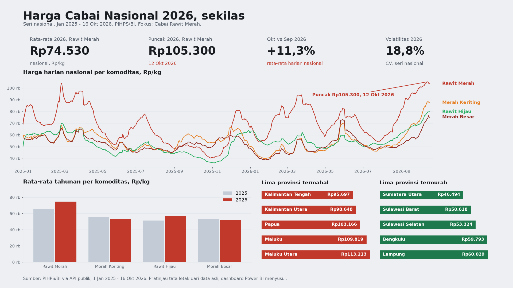

# Analisis Harga Cabai Indonesia 2026

Analisis harga 4 komoditas cabai di Indonesia pada 2026: tren nasional,
volatilitas, lonjakan Oktober 2026, dan disparitas antar provinsi.
Dilengkapi paket dashboard Power BI (star schema, measure DAX, panduan rakit).

## Sumber data: API publik PIHPS / Bank Indonesia

**Data ditarik langsung dari API resmi PIHPS** (hargapangan.id,
Pasar Tradisional) dengan `scripts/fetch_pihps.py` — bukan salinan dataset
pihak lain. Endpoint:

```
GET https://www.bi.go.id/hargapangan/WebSite/TabelHarga/GetGridDataKomoditas
?price_type_id=1 &comcat_id=com_13|com_14|com_15|com_16
&province_id=<id> &showKota=false &showPasar=false &tipe_laporan=1
&start_date=2025-01-01 &end_date=2026-10-16
```

Tidak perlu login atau API key. Respons mentah disimpan di
`data/raw/pihps_chunks/` (127 file JSON). Cakupan: 2025-01-01 s.d.
2026-10-16, 1,872 baris nasional (4 komoditas x
468 hari pelaporan) + 59,436 baris provinsi
(58,253 dengan harga).

**Catatan jujur tentang gap.** PIHPS tidak mempublikasikan seri provinsi untuk
9 kombinasi provinsi x komoditas. Kombinasi tersebut dicatat
sebagai gap, tidak diisi angka lain dan tidak diinterpolasi:

- Aceh — Cabai Rawit Merah
- Gorontalo — Cabai Merah Besar
- Gorontalo — Cabai Rawit Hijau
- Kepulauan Bangka Belitung — Cabai Merah Besar
- Kepulauan Riau — Cabai Merah Besar
- Sulawesi Utara — Cabai Merah Besar
- Sumatera Barat — Cabai Merah Besar
- Sumatera Barat — Cabai Rawit Merah
- Sumatera Utara — Cabai Merah Besar

## Ringkasan Eksekutif

- **Rata-rata nasional 2026:** Cabai Rawit Merah Rp74.530/kg
  (+13.3% vs 2025); Cabai Rawit Hijau
  Rp56.578/kg (+10.7%);
  Cabai Merah Keriting Rp53.277/kg
  (-4.2%); Cabai Merah Besar
  Rp51.706/kg (-2.9%).
- **Volatilitas 2026 (CV):** Cabai Merah Keriting paling liar
  (20.0%), disusul Cabai Rawit Merah
  (18.8%), Cabai Merah Besar
  (16.1%), Cabai Rawit Hijau paling stabil
  (12.3% ).
- **Lonjakan Oktober 2026:** Cabai Rawit Merah menembus Rp100.000/kg pada
  2026-09-30
  (Rp100.550/kg), lalu menembus Rp105.000/kg pada
  2026-10-12
  (Rp105.300/kg). Kenaikan terbesar terjadi
  pada September (MoM +39.3%), lalu Oktober naik lagi
  +11.3%. Keempat komoditas mencapai puncak 2026
  dalam jendela yang sama, 12–16 Oktober 2026.
- **Lonjakan harian terbesar 2026:** Cabai Merah Keriting
  +20.4% pada
  2026-05-25.
- **Disparitas provinsi 2026 (Cabai Rawit Merah):** termahal Maluku Utara
  (Rp113.213/kg), termurah Sumatera Utara
  (Rp46.494/kg) — selisih Rp66.719/kg
  (143.5%). Untuk Cabai Rawit Hijau selisihnya bahkan
  236.2% (Maluku Utara vs Sulawesi Selatan).
- **DKI Jakarta vs nasional 2026 (Cabai Rawit Merah):**
  Rp78.792/kg, yaitu
  +5.7% terhadap
  rata-rata nasional. Jakarta tidak termasuk provinsi termahal — harga tertinggi
  ada di provinsi timur (Papua, Maluku, Maluku Utara).

## Isi proyek

- `analysis.ipynb` — notebook narasi: SQL + chart + insight (20 sel).
- `data/raw/` — `harga_cabai_harian.csv` (provinsi), `harga_cabai_nasional.csv`,
  `pihps_chunks/` (respons mentah API).
- `data/harga_cabai.db` — SQLite (dibuat ulang via `scripts/load_to_sqlite.py`,
  tidak ikut dalam zip).
- `sql/queries.sql` — 16 query (seri nasional + per provinsi).
- `scripts/` — `fetch_pihps.py`, `load_to_sqlite.py`, `analyze.py`,
  `make_charts.py`, `build_powerbi.py`.
- `charts/` — 10 chart PNG.
- `powerbi/` — kit dashboard: `fact_harga_cabai.csv`, `dim_komoditas.csv`,
  `dim_wilayah.csv`, `dim_tanggal.csv`, `measures_dax.md` (15 measure),
  `dashboard_layout.md` (4 halaman), `build_guide.md` (rakit di Power BI Desktop Windows).
- `findings.json` — semua angka kunci hasil komputasi dari data.
- `Portofolio-Analisis-Harga-Cabai.pptx` — deck portofolio 10 slide 16:9.
- `Modul-Analisis-Harga-Cabai.pdf` — modul belajar untuk pemula.

## Paket Power BI

Data yang sama disusun ulang menjadi star schema di `powerbi/`. Cara merakit:
lihat `powerbi/build_guide.md` (import CSV, buat 3 relasi, tandai tabel tanggal,
tempel 15 measure DAX, bangun 4 halaman sesuai `dashboard_layout.md`).
Perakitan dilakukan di Power BI Desktop di Windows — folder ini hanya berisi
bahan siap import, bukan file `.pbix`.

### Pratinjau dashboard



Pratinjau tata letak halaman 1 (Overview) yang dibuat langsung dari data asli
repo ini. GitHub tidak bisa me-render file `.pbix`, jadi pratinjau ini yang
tampil di halaman repo sampai dashboard Power BI-nya selesai dirakit.

## Cara mereproduksi

```bash
python scripts/fetch_pihps.py        # tarik data dari API PIHPS
python scripts/load_to_sqlite.py    # muat ke SQLite
python scripts/analyze.py          # hitung findings.json
python scripts/make_charts.py      # buat 10 chart
python scripts/build_powerbi.py    # bangun kit Power BI
python build_notebook.py build_ppt.py build_module.py
```

## Keterbatasan

- PIHPS melaporkan pada hari kerja pasar, bukan setiap hari kalender — ada
  tanggal tanpa laporan. Hari tanpa laporan tidak pernah diisi nol atau
  diinterpolasi.
- 9 kombinasi provinsi x komoditas tidak dipublikasikan PIHPS
  (dicatat sebagai gap).
- Analisis ini tidak mengklaim penyebab lonjakan (misalnya cuaca atau pasokan),
  karena data harga saja tidak cukup membuktikannya.
